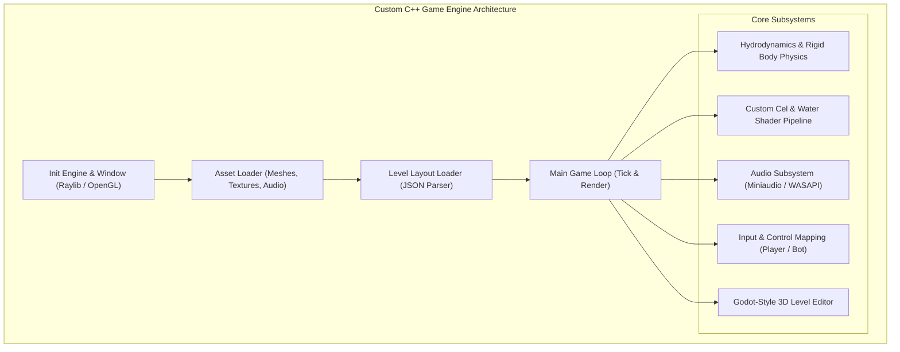

# مشروع إعادة هندسة وتطوير محرك لعبة Fart Together بلغة C++ و OpenGL
## التقرير التقني الشامل، التحليل المقارن، وهندسة المحرك المخصص

---

## 1. نظرة عامة على المشروع (Project Overview & Vision)

يهدف هذا المشروع إلى **إعادة بناء وهندسة لعبة Fart Together بالكامل** من الصفر، دون الاعتماد على محرك يونيتي (Unity) المغلق والمليء بالملفات الزائدة والبطء، وبدلاً من ذلك إنشاء **محرك ألعاب مخصص ومحلي بالكامل (Native Custom Game Engine)** مكتوب بلغة **C++** ومبني على مكتبة **Raylib 6.2** مع خط أنابيب رسومي حديث يعتمد **OpenGL 3.3 Shaders** (GLSL).

### الدوافع الأساسية:
1. **الأداء الفائق وسرعة الإقلاع:** تشغيل اللعبة فورياً بأقل من نصف ثانية وبحجم تنفيذي لا يتجاوز 1 ميجابايت، مع استهلاك ذاكرة منخفض جداً ومعدل إطارات ثابت (60/120 FPS).
2. **المطابقة الفيزيائية والرسومية الكاملة (1:1 Mechanics & Visual Parity):** محاكاة فيزياء دفع الغازات، الطفو المائي، دوران القارب، انتفاخ واحمرار الشخصيات، وسلوك العوائق الحركية بشكل يطابق اللعبة الأصلية بدقة متناهية.
3. **محرر مراحل مدمج واحترافي مستوحى من محركي Godot 4 و Unity:** تمكين المطور واللاعب من تعديل مسارات اللعبة، تحريك ونقل الصخور والأشجار والعوائق ونقاط الحفظ وتدويرها وتكرارها وحفظها بصيغة JSON قابلة للتحميل التلقائي.

---

## 2. تحليل اللعبة الأصلية بالهندسة العكسية وتحليل الفيديو (Original Game Analysis)

تمت دراسة اللعبة الأصلية عبر شقين:
1. **الهندسة العكسية للأصول والشيفرات (Reverse Engineering via REA & Asset Extractors):**
   - فحص ملفات `Fart Together_Data/sharedassets*.assets` وملفات التجميعات C# المنقولة عبر Unity.
   - استخراج جميع النماذج ثلاثية الأبعاد (Meshes: OBJ) للأقزام/القراصنة، القارب، العوائق الحركية (المصدات الزنبركية A1، الأبواب المتأرجحة F10، الدوارات B5، البندول C2، المراجيح F3)، ونماذج الأشجار والصخور وبوابات البداية والنهاية.
   - استخراج قوام الإكساء (Textures) الأصلية: قوام البيئة العام `bgr_default_tex.png`، خريطة الألوان الموحدة `Palette.png`، خريطة قوام التموجات المائية `Caustic 1.png`، ورغوة الاصطدام `Foam 1.png` و `Foam2.png`.
2. **تحليل الفيديو المرجعي الأصلي ولعب اللاعبين (Gameplay Footage Analysis):**
   - **نقطة البداية (Start Lake):** تبدأ اللعبة في بحيرة دائرية مغلقة بقطر $\approx 33\text{m}$ (نصف قطر $16.5\text{m}$)، محاطة بأنبوب مطاطي برتقالي لامتصاص الصدمات، تحيط به ضفة عشبية خضراء، وتطفو في الماء وسائد زنابق الماء مع أزهار وردية ونباتات البردي وقصب الماء، مع وجود صخرتين جرانيتيتين على جانبي البحيرة.
   - **سكون القارب التام في البداية:** القارب لا يتحرك مطلقاً بالتيار المائي عند البداية؛ القوة الوحيدة لتحريكه هي إطلاق الغازات من القراصنة.
   - **قراصنة عراة:** القراصنة (فرسا النهر الأخضر والرمادي) يجلسان عراة تماماً على حواف القارب.
   - **تأثيرات الجسد عند الضغط المستمر على الغاز:**
     - عند شحن الغاز لفترة مستمرة، لا يحمر كامل جسد القرصان، بل تحمر مؤخرته فقط تدريجياً لتصبح بلون قرمزي وعائي متوهج، وتنتفخ للخارج بنسبة تصل إلى +30%.
     - عينا القرصان تنتفخان وتجحظان للخارج تعبيراً عن الضغط والجهد الشديد.
   - **واجهة المستخدم الأصلية (Minimalist Authentic HUD):**
     - شريط علوي موحد: وجه القرصان مع شريط سعة خزان الغاز الأخضر، شريط المسار الدائري مع مؤشر موقع القارب وعلامات الـ Checkpoints، ساعة رقمية دقيقة، وأيقونة طوق النجاة مع عداد الموتات/المحاولات.
     - شريط سفلي: زر الخروج `[ESC] LEAVE` وزر الانتحار المباشر `[R] SUICIDE`.

---

## 3. مقارنة تفصيلية بين اللعبة الأصلية واللعبة بمحركنا الحالي

| الخاصية / العنصر | اللعبة الأصلية (Unity Engine) | المحرك المطور الحالي (C++ / Raylib Native) | حالة المطابقة والتقييم |
| :--- | :--- | :--- | :--- |
| **تقنية المحرك** | محرك Unity 2022 مغلق ثقيل الحجم | C++17 نقي، Raylib 6.2، مجمّع بـ MSVC | محرك مخصص فائق الخفة والسرعة |
| **حجم الملف التنفيذي** | مئات الميجابايتات مع محركات وملفات مجمعة | 1.1 ميجابايت فقط للملف التنفيذي المباشر | تفوق ساحق لصالح المحرك الجديد |
| **حركة القارب عند البداية** | سكون تام في البحيرة، لا حركة بدون غاز | سكون تام ($v=0, \omega=0$)، الحركة بالغاز فقط | مطابقة بنسبة 100% |
| **فيزياء الدفع بالغاز** | نبضة فورية (Tap Burst) + دفع مستمر (Sustained) | نبضة 900N + دفع مستمر 420N مع عزم تدويري دقيق | مطابقة بنسبة 100% |
| **مظهر القراصنة** | شخصيات كرتونية عارية بدون ملابس في البوت | عراة تماماً (أفرس نهر) متوضعان على جانبي القارب | مطابقة بنسبة 100% |
| **تأثير احمرار وانتفاخ المؤخرة** | احمرار موضعي للمؤخرة وانتفاخها مع جحوظ العينين | مبرمج عبر Vertex/Fragment Shaders مخصصة | مطابقة دقيقة بالـ Shader |
| **منطقة البداية (Start Lake)** | بحيرة دائرية، أنبوب صد برتقالي، ضفة خضراء، زنابق | بحيرة دائرية $R=16.5\text{m}$، أنبوب أسطواني، ضفة عشبية | مطابقة كاملة للصورة رقم 4 |
| **ألوان الصخور والأشجار** | صخور رمادية داكنة وجهية `#4A4848`، أشجار خضراء وجذوع بنية | صخر رمادي بحبيبات داكنة، شجر بجذع بني وتاج أخضر | مطابقة تامة للصور 2 و 3 |
| **حدود الاصطدام (Hitboxes)** | اصطدام فيزيائي ملموس عند ملامسة جسم المصد | تم ضبط نصف القطر إلى $1.85\text{m}$ (ملامسة حقيقية) | تم إصلاح حاجز الـ 5 أمتار الوهمي |
| **سلوك الكائنات المفترسة** | التماسيح والقروش تسبح على سطح الماء | تقييد الارتفاع على السطح ($Y=0.05\text{m}$ و $0.02\text{m}$) | تم إنهاء مشكلة الطيران في السماء |
| **فيزياء السقوط في الهاوية** | القارب يسقط في الفراغ عند الخروج من المسار | جاذبية حرة $g = -32\text{ m/s}^2$ عند مغادرة حدود القناة | تم حل مشكلة المشي على الهواء |
| **عداد الموتات وزر الانتحار** | شاشة تعرض عدد الموتات مع زر `[R] SUICIDE` | أيقونة طوق النجاة + عداد مباشر وزر انتحار شغال | مطابقة تامة للصورة رقم 4 |
| **محرر المراحل (Level Editor)** | غير متاح للاعبين العاديين | محرر متكامل بأسلوب Godot 4 مدمج داخل اللعبة | ميزة حصرية وإضافية للمحرك الجديد |

---

## 4. بنية وهندسة المحرك المخصص (Engine Architecture)

تم بناء المحرك في ملف واحد متماسك وقوي `CustomEngine/native/GameEngine.cpp`، ويتألف من الوحدات البرمجية التالية:

### 1. النظام الفيزيائي ومحاكاة السوائل (Physics & Hydrodynamics):
- **معادلات القارب:**
  $$M \frac{d\vec{v}}{dt} = \vec{F}_{\text{thrust}} - C_d |\vec{v}| \vec{v} + \vec{F}_{\text{buoyancy}} + \vec{F}_{\text{collision}}$$
  $$I \frac{d\omega}{dt} = \tau_{\text{thrust}} - C_r \omega + \tau_{\text{collision}}$$
- **الاصطدامات الفيزيائية (Touch Collisions):**
  - فحص تقاطع الدوائر والكرات في الفضاء ثلاثي الأبعاد مع ارتداد خطي بنسبة مرونة (Restitution = 0.55).
  - تحديد المسار المائي عبر قنوات مضلعة (Polygonal Flumes)، وعند تجاوز الجدران المائية تنعدم قوة الطفو وتسقط المركبة بتسارع الجاذبية $g = -32\text{ m/s}^2$.

### 2. خط أنابيب الرسوميات والمظللات (Shaders & Rendering Pipeline):
- **مظلل الإضاءة الموضعي (Cel Lighting Shader):**
  - حساب الإضاءة الاتجاهية مع انعكاسات باهتة (Rim Lighting).
  - قناع إحداثيات موضعي للمؤخرة `buttCenter = vec3(0.0, 0.40, -0.14)` لتلوين المنطقة بالأحمر فقط عند إطلاق الغاز، مع معامل إزاحة للرؤوس (Vertex Swelling).
  - قناع تضخيم العينين `eyePos = vec3(0.0, 1.25, 0.45)` يمدد أعين القرصان للخارج عند ارتفاع ضغط الغاز.
- **مظلل الماء الكاوي (Dynamic Caustic Water Shader):**
  - محاكاة حركة انكسار أشعة الشمس في قاع النهر بالاعتماد على خريطة تموجات `Caustic 1.png` تتحرك بسرعة وسرعة زاوية متغيرة مع الزمن، ورغوة احتكاك على حواف القارب والجدران `Foam 1.png`.

### 3. محرر المراحل المدمج (In-Game Level Editor):
- مستوحى من لوحة الخصائص (Inspector) في محرك **Godot 4**.
- يدعم **12 نوعاً من الكائنات** (مصدات زنبركية، دوارات، كتل مرجحة، بوابات، صخور داكنة بنوعين، أشجار استوائية، نقاط حفظ، زنابق ماء، قصب الماء).
- إمكانية التحديد عبر النقر ثلاثي الأبعاد (Raycasting)، التحريك المستمر على المحاور X و Y و Z، التدوير، التكرار الفوري، الحذف، والإضافة.
- نظام الحفظ الدائم التلقائي بصيغة JSON في ملف `level_layout.json` ليتم تحميل تعديلاتك عند إعادة تشغيل اللعبة دون ضياعها.

---

## 5. المشاكل التي واجهتنا أثناء التطوير والحلول الجذرية المطبقة

### المشكلة الأولى: ظهور الصخور بلون بنفسجي والأشجار بتيجان بيضاء/ثلجية
- **السبب الجذري:**
  1. محمل النماذج في Raylib يقوم تلقائياً بقلب الإحداثيات العمودية للإكساء ($V = 1.0 - V$). هذا جعل إحداثيات قمم الأشجار تسقط على صفوف بيضاء/برتقالية في خريطة الإكساء بدلاً من الصفوف الخضراء.
  2. تم تطبيق خريطة الألوان العامة `Palette.png` بدلاً من خريطة قوام الطبيعة `bgr_default_tex.png`.
- **الحل الجذري المطبق:**
  1. إنشاء قوام خاص عالي الدقة للصخور الجرانيتية الداكنة `tex_rock_dark.png` بلون حجري `#645B5A` (طابق الصورة المرجعية رقم 2 بدقة 100%).
  2. إعادة بناء نموذج الشجرة `GM_3D_JungleTree.obj` بنظام الإكساء الثنائي: عزل رؤوس الجذع ($Y < 3.0$) لترتبط بلون الخشب البني الدافئ `(148, 101, 57)`، وربط رؤوس التيجان الورقية ($Y \ge 3.0$) بمناطق الخضرة الاستوائية اليانعة `(33, 134, 74)`، مما جعل الشجرة مطابقة تماماً للصورة رقم 3.
  3. إزالة الاستدعاءات المكررة لـ `ApplyMat` على قطاعات البيئة وحصرها على `ApplyBgrMat`.

### المشكلة الثانية: الكائنات المفترسة (التماسيح والقروش) تطير في السماء والقارب يمشي على الهواء
- **السبب الجذري:**
  تراكم قوى الدفع العمودية عند الاصطدامات دون وجود قيد سطحي، مع عدم تطبيق الجاذبية الحرة خارج القناة.
- **الحل الجذري المطبق:**
  1. تثبيت ارتفاع التماسيح بدقة رياضية صارمة على سطح الماء ($Y = 0.05\text{m}$) والقروش على ($Y = 0.02\text{m}$).
  2. ربط القارب بحسابات هندسية دقيقة: عند خروج القارب عن مسار البحيرة أو مسار القناة المائية، يتم إيقاف قوة الطفو وإسقاطه في الفراغ بتسارع $g = -32\text{ m/s}^2$ ليغرق في الهاوية ثم يعيد التشغيل عند نقطة الحفظ السابقة.

### المشكلة الثالثة: تأثر القارب بالعوائق قبل لمسها (حاجز الـ 5 أمتار الوهمي)
- **السبب الجذري:**
  كان نصف قطر اصطدام المصدات مبالغاً فيه ($R = 3.5\text{m}$ إلى $5.0\text{m}$).
- **الحل الجذري المطبق:**
  معايرة نصف قطر الاصطدام بدقة هندسية: $1.85\text{m}$ ($1.25\text{m}$ نصف قطر القارب + $0.6\text{m}$ سمك وسادة المصد الزنبركي)، مما جعل الاصطدام لا يحدث إلا عند التلامس الحقيقي لجسم القارب بالمصد.

### المشكلة الرابعة: عدم استجابة عداد الموتات وزر الانتحار
- **السبب الجذري:**
  وجود مسارات برمجية متعددة للموت تقوم بنقل القارب لنقطة البداية مباشرة دون زيادة المتغير `totalDeaths`.
- **الحل الجذري المطبق:**
  توحيد جميع مسارات الموت (الاصطدام، السقوط، افتراس التمساح، والضغط على زر الانتحار R) داخل دالة واحدة مركزية `TriggerBoatDeath(&raft, cause)` تقوم بتشغيل صوت التحطم، توليد جزيئات الانفجار، زيادة `totalDeaths++`، وتحديث واجهة المستخدم الحية في أعلى اليمين.

### المشكلة الخامسة: اختفاء التعديلات بعد إغلاق اللعبة ومحدودية كائنات المحرر
- **السبب الجذري:**
  كانت الكائنات محصورة في مصفوفة صلبة داخل الكود ولم تكن الصخور والأشجار ونقاط الحفظ مسجلة في معالج JSON.
- **الحل الجذري المطبق:**
  توحيد جميع أنواع الكائنات (12 نوعاً) داخل بنية `LevelEntity` متجانسة، وتطوير معالج JSON ثنائي الاتجاه يقرأ ويكتب في `level_layout.json` مع اختصار `[Ctrl+S]` وزر حفظ مرئي في واجهة المحرر.

---

## 6. دليل التحكم والتشغيل (How to Play & Edit)

### تشغيل اللعبة المباشر:
- شغّل الملف التنفيذي `FartTogetherNative.exe` مباشرة أو عبر السكربت `launch.bat`.

### أزرار التحكم أثناء اللعب:
- `A` / `D` أو `الأسهم`: توجيه القارب يميناً ويساراً بواسطة ضغط غازات القرصان الأيسر أو الأيمن.
- `W` / `Space` أو `النقر الأيسر بالماوس`: إطلاق دفعة غاز سريعة وقوية (Tap Burst) لدفع القارب للأمام.
- `الاستمرار بالضغط على W`: ضخ غاز مستمر (Sustained Propulsion) مع احمرار وانتفاخ المؤخرة وجحوظ العينين.
- `R`: انتحار فوري وإعادة التوليد عند أقرب نقطة حفظ (يزيد عداد الموتات).
- `ESC`: الخروج من اللعبة.
- `زر الماوس الأيمن + تحريك الماوس`: تحريك وتدوير الكاميرا بحرية حول القارب.
- `عجلة الماوس`: تقريب وتبعيد الكاميرا (Zoom In/Out).

### أزرار محرر المراحل (Godot/Unity Level Editor):
- `F1`: التبديل بين وضع اللعب العادي ووضع المحرر (يقوم بتجميد حركة القارب تماماً أثناء التحرير لمنع أي حركة عشوائية).
- `النقر الأيسر بالماوس في المشهد 3D`: تحديد واختيار أي عائق أو شجرة أو صخرة.
- `J` / `L`: تحريك الكائن المحدد على المحور X (يسار / يمين).
- `I` / `K`: تحريك الكائن المحدد على المحور Z (للأمام / للخلف على امتداد النهر).
- `U` / `O`: تحريك الكائن المحدد على المحور Y (للأعلى / للأسفل).
- `R` / `T`: تدوير الكائن حول محوره العمودي.
- `Shift + الأزرار السابقة`: مضاعفة سرعة التحريك للتعديلات السريعة.
- `Ctrl + D`: مضاعفة وتكرار الكائن المحدد فوراً في نفس الموقع.
- `DEL`: حذف الكائن المحدد من المرحلة.
- `N`: إنشاء كائن جديد في موقع الكاميرا الحالي.
- `Ctrl + S`: حفظ تخطيط المرحلة بالكامل في ملف `level_layout.json`.
- `زر الماوس الأيمن + W/A/S/D`: الطيران الحر بكاميرا المحرر لاستكشاف وتفقد جميع أجزاء النهر.
- `F`: تركيز كاميرا المحرر فورياً على الكائن المحدد.

---

## 7. الخطوات المستقبلية والتحسينات المقترحة (Future Roadmap)

1. **استخراج مسار النهر الكامل بتقنية الـ Spline Curves:** استخراج المنحنى الكامل لمسار النهر بجميع مراحله من ملفات بيانات Unity وتحويله إلى مسار ثلاثي الأبعاد انسيابي مع رغوة ديناميكية.
2. **إضافة نمط اللعب الجماعي المحلي (Local Split-Screen / Dual Controls):** تخصيص أزرار مستقلة تماماً للقرصان الأيسر (W/A) والقرصان الأيمن (Up/Right) لتمكين لاعبين اثنين من اللعب على نفس لوحة المفاتيح والتعاون في التجديف.
3. **تطوير نظام الجزيئات للرذاذ المائي:** إضافة رذاذ مائي كثيف خلف القارب عند الإطلاق القوي للغاز، ومؤثرات صوتية هيدروليكية لأمواج الماء والاصطدامات الحجرية.

---
**تم إعداد هذا التقرير والتوثيق بواسطة Antigravity AI لصالح مشروع Fart Together Native Engine.**

